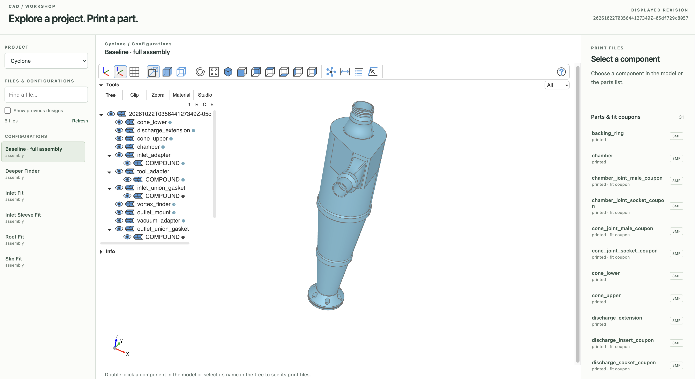

# CAD tooling

This repository owns the shared build storage and web preview for the CAD projects in `../projects/`.

`src/cad_build` is a standard-library-only package for immutable builds and provenance.
`src/cad_viewer` displays those builds; building geometry does not import or require the viewer. The Python server, project catalog, scene conversion, browser assets, and viewer checks live here; project geometry and generated exports remain in their project directories.



The workspace layout is:

```text
cad/
  cad-tooling/       # this repository: cad_build and cad_viewer
  projects/
    cyclone/
    vault/
```

## Run locally

The pinned Nix environment and Python lock are independent of Cyclone's environment. From this directory:

```sh
nix develop path:. -c just setup
nix develop path:. -c just view
```

The server listens on `127.0.0.1:3939` and discovers designs in `../projects/`. Use another free port or workspace explicitly:

```sh
nix develop path:. -c just view 3940 /path/to/cad
```

The underlying command is `python -m cad_viewer view --port 3939 --workspace ../projects`. `--build-dir` selects a single immutable Cyclone build for the legacy streamed preview. Starting the viewer does not build or alter any project's geometry, move Vault files, or modify host services. Reference files under `original_files` are excluded from discovery.

## Projects and configurations

Choose a project, then a file or configuration. The URL retains that selection, and separate tabs can show different models. A project without successful exports appears with an empty-state message.

For Cyclone and Vault, every successful build is listed under an expandable Git commit message, with the newest commit dates first and newest builds first within each group. Build rows show their configuration, build start time, and whether the checkout had uncommitted changes. New builds record the starting commit, full commit message, commit date, and working-tree status in their manifest. Builds without valid recorded provenance appear under **Unlinked builds**; timestamps are never used to guess a commit. Source snapshots remain the authoritative record for modified checkouts.

The shared [build library](docs/builds.md) writes `cad-build-v1` manifests for both projects. The viewer also reads legacy successful `out/**/build.json` exports, including older Vault files, without rewriting them. Original exports are read without modification. Mesh reduction, when necessary for preview performance, affects only the displayed scene.

Safari uses reduced graphics settings to limit GPU memory use. A lost WebGL context stops automatic recovery and displays an explicit reload message. The `?graphics=safe` query option enables the same profile in other browsers.

## Checks

```sh
nix develop path:. -c just check
nix develop path:. -c just browser-check
nix develop path:. -c just browser-check-safe
```

The browser checks use the pinned Chromium executable and temporary exported fixtures, covering project/file selection, separate tabs, history, downloads, empty/error states, and graphics-context loss. They do not rebuild Cyclone geometry. Check reports and screenshots are written under `out/`.

The extracted environment retains the existing dependency versions: Python 3.12, build123d 0.13.0, cadquery-ocp-novtk 8.0.1.1.0, ocp-viewer 1.1.3, ocp-viewer-core 1.0.13, trimesh 4.12.2, numpy 2.5.3, websockets 17.2, pytest 9.0.2, and Playwright 1.58.0. Shell entry never installs dependencies; `just setup` installs the lock explicitly.

## Existing deployment

Cyclone's existing viewer commands delegate to this application for compatibility. Existing service launchers need to reference the new `projects/cyclone` or `cad-tooling` paths. This extraction does not change NixOS, nginx, authentication, or the public listener configuration.

### Sharing geometry with an agent

Click an edge or face to lock its reference in the **Agent reference** panel.
Moving the pointer or orbiting the model does not replace it. Use **Alt+C** or
**Copy reference** to copy it, or type a message and click **Send to Codex**.
For example:
“Please simplify the geometry around this edge while preserving the outer
dimensions and mounting holes.” A screenshot alongside the reference helps
communicate the intended region.

The reference includes the displayed file/revision, geometry path, tessellated
world bounds, edge endpoints when available, the clicked point, and camera.
Paths apply only to that revision; they are not persistent IDs across rebuilds
or source-code locations. Coordinates reflect display transforms, including
exploded or scaled views. The URL opens the file, not the captured selection or
camera, and the file may have changed since capture. The reference is cleared
when the model changes. If clipboard access fails, copy from the text box shown.

Each send runs a new Codex task in the selected project with the captured reference
and your message. Codex may edit project files using a workspace-write sandbox;
it is instructed to leave staging and committing to you. The reply appears in
the panel. Requests are not automatically retried if the connection drops, because
the agent may still be working. Review changes before resending. Only one geometry
agent request runs at a time. This uses the same Codex CLI configuration as commit
message drafting. In pinned/live previews, references can be copied but direct
sending requires selecting a project from the catalog.

### Stage and commit from the viewer

Open **Stage & commit changes** in the project sidebar. Refresh the changed-file
list, select files, and choose **Stage selected files**. Staging includes the full
file, including deletions. The panel shows existing staged files too; committing
includes all staged changes in the selected project's repository.

After staging, an empty message is automatically filled by `codex exec` using the
staged diff (up to 100 KB). The viewer process needs the Codex CLI on its PATH and
an authenticated Codex configuration. Generation uses a read-only sandbox. You can
edit the draft, request another draft, or write a message manually if AI is
unavailable. Click **Commit staged changes** to create the local commit. Nothing
is pushed. Git identity and hooks use the project's normal configuration.

Changes to the staged diff or HEAD after review require a refresh before commit.
Git commands use a same-origin WebSocket and require the selected project to be
its repository root. Saved build provenance remains unchanged by a new commit.

For service deployments, include Git and Node.js in the service PATH and set
`CAD_VIEWER_CODEX` to the installed Codex launcher when it is outside that PATH.
A read-only service must explicitly allow repository writes for staging/committing
and Codex state writes for AI drafting. The proposed NixOS adjustments are in
[the service patch](docs/deployment/cad-viewer-service.patch); applying them changes
the service's filesystem permissions and requires administrator approval.

### Build a preview

Use **Build preview** in the project sidebar to build a declared configuration.
`partcad.json` lists maintained parts and assemblies; `cad-builds.json` binds them
to the existing project builders. The picker works before the first build and
independently of the displayed historical file. Vault initially declares S4
Module 1F and S1F Facade; Cyclone declares the baseline assembly and its parts.
See [JSON catalogs](docs/catalogs.md) for the supported schema and validation.

The Parts list survives removal of generated output. Other saved exports remain
available in Build history. Build freshness is separate from human review;
existing builds are not automatically marked reviewed.

The viewer streams build output and displays an activity indicator while the
previous model remains visible. Successful builds automatically open the exact
newly published revision. If you navigate elsewhere during a build, your new
selection is preserved; refresh the project's files to find the result. Failed
builds keep the existing preview and show their output. Builds time out after
30 minutes. A disconnected build socket stops a running build; if disconnection
happens during publication, refresh the file list before retrying.

Both projects use `cad_build.run_build` for staging, metadata, validation gating,
immutable publishing, and latest pointers, and `python -m cad_build.runner` for
viewer execution. Project adapters provide their geometry, exports, and domain
checks. Builds use each project's prepared virtualenv and the viewer's native
library environment; they never install dependencies. Agent edits and preview
builds share a lock. Existing CLI/just build commands use the same pipeline.

Run `python -m cad_viewer.browser_build_check` in the tooling environment for
browser coverage of progress, errors, and automatic preview loading.
